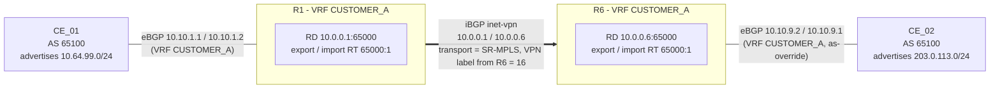
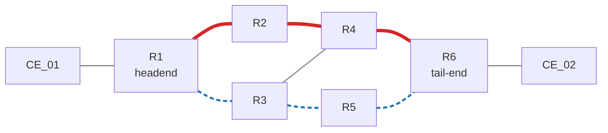
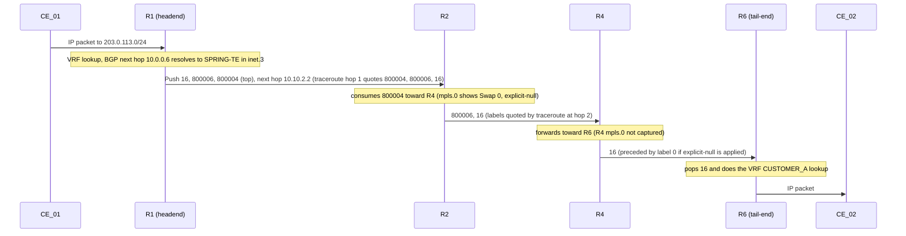

# Topology

All diagrams are Mermaid, so they render on GitHub and are maintained as text. They were built from the router configurations and checked against the author's draw.io screenshot. The one known mismatch (the screenshot's NET table for Router1 and its stale `Ext_Router` loopback rows) is recorded in the [consistency audit](consistency-audit.md).

## 1. Physical and logical topology

```mermaid
flowchart LR
  subgraph S1["Customer site 1 - AS 65100"]
    VPC1["VPC<br/>10.64.99.10/24"]
    CE1["CE_01<br/>lo0 192.168.1.1/32<br/>LAN 10.64.99.1/24"]
  end
  subgraph CORE["MPLS / Segment Routing domain - AS 65000 - IS-IS L2 - SRGB 800000-819999"]
    R1["R1 - PE, SR-TE headend<br/>lo0 10.0.0.1/32<br/>Node-SID 1 = 800001"]
    R2["R2 - P<br/>lo0 10.0.0.2/32<br/>Node-SID 2 = 800002"]
    R3["R3 - P<br/>lo0 10.0.0.3/32<br/>Node-SID 3 = 800003"]
    R4["R4 - P<br/>lo0 10.0.0.4/32<br/>Node-SID 4 = 800004"]
    R5["R5 - P<br/>lo0 10.0.0.5/32<br/>Node-SID 5 = 800005"]
    R6["R6 - PE<br/>lo0 10.0.0.6/32<br/>Node-SID 6 = 800006"]
  end
  subgraph S2["Customer site 2 - AS 65100"]
    CE2["CE_02<br/>lo0 192.168.2.1/32<br/>LAN 203.0.113.1/24"]
    VPC2["VPC<br/>203.0.113.10/24"]
  end
  VPC1 ---|"eth0 to ge-0/0/1"| CE1
  CE1 ---|"ge-0/0/0 .1 to R1 ge-0/0/2 .2<br/>10.10.1.0/30 eBGP"| R1
  R1 ---|"ge-0/0/0 .1 to ge-0/0/0 .2<br/>10.10.2.0/30"| R2
  R1 ---|"ge-0/0/1 .1 to ge-0/0/2 .2<br/>10.10.3.0/30"| R3
  R2 ---|"ge-0/0/1 .1 to ge-0/0/2 .2<br/>10.10.4.0/30"| R4
  R3 ---|"ge-0/0/0 .1 to ge-0/0/0 .2<br/>10.10.8.0/30"| R4
  R3 ---|"ge-0/0/1 .1 to ge-0/0/2 .2<br/>10.10.5.0/30"| R5
  R4 ---|"ge-0/0/1 .1 to ge-0/0/2 .2<br/>10.10.6.0/30"| R6
  R5 ---|"ge-0/0/0 .1 to ge-0/0/0 .2<br/>10.10.7.0/30"| R6
  R6 ---|"ge-0/0/1 .2 to CE_02 ge-0/0/0 .1<br/>10.10.9.0/30 eBGP"| CE2
  CE2 ---|"ge-0/0/1 to eth0"| VPC2
```

Reading the link labels: the first interface and `.1`/`.2` belong to the router on the left of the arrow text. Full tables are in [addressing.md](addressing.md).

## 2. Service view: L3VPN relationships

R2 to R5 carry no BGP and no VRF: they only forward labels (BGP-free core).

## 3. SR-TE forwarding path (R1 to R6)

| Style | Meaning |
|---|---|
| Thick red | **SR-TE primary** `SRTE_R1_R2_R4_R6`: R1, R2, R4, R6 |
| Dashed blue | **SR-TE secondary** `SRTE_R1_R3_R5_R6`: R1, R3, R5, R6 |
| Grey | Link in the IGP topology that neither SR-TE path uses (R3 to R4) |

> **Release 1.1.0:** R1's IS-IS metric toward R2 is 100, so the IGP and plain SR to R6 use the R3 side (cost 30: R1-R3-R4-R6 and R1-R3-R5-R6) while the red SR-TE primary crosses R2 (IGP cost 120). The red path is therefore a genuine detour, and the dashed blue secondary is an equal-cost IGP path. In release 1.0.0 every metric was 10 and the primary was one of three equal-cost paths, so it was pinned, not diverted. See [design decisions](design-decisions.md) and [lab 05](../labs/05-sr-te/README.md). The host-to-host trace (captured) follows the red path in the forward direction; the return direction is not engineered.

## 4. Label operations on the engineered path

Evidence: R1's `inet.3` and `show route` output (push stack), the VRF traceroute from R1 to 10.10.9.1 (hops R2 then R4 then R6 then CE_02, with the label stacks at R2 and R4), R2's `mpls.0` (`800004 ... Swap 0`) and R1's `mpls.0` (`0(S=0)` pops to `mpls.0`). The traceroute's quoted stack at R4 does not list a label 0, so the explicit-null detail rests on the `mpls.0` and `inet.3` entries. R4's own forwarding action is inferred.
